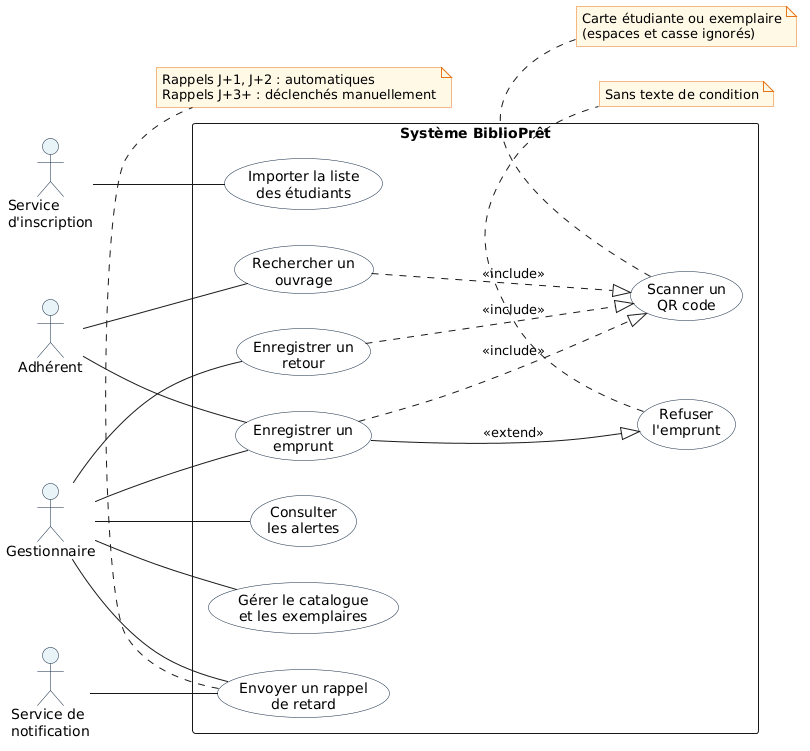
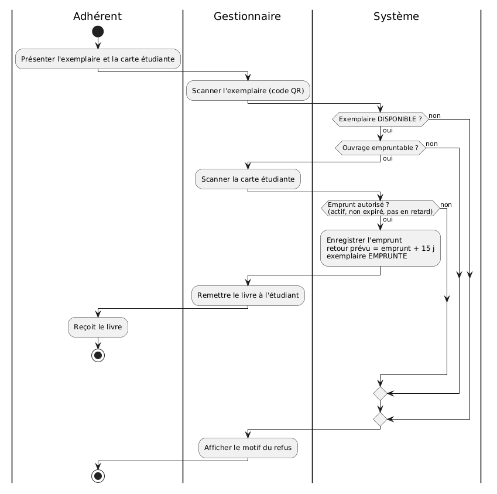
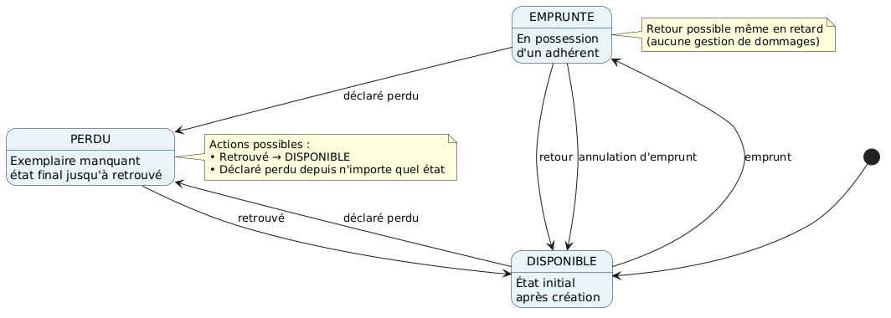
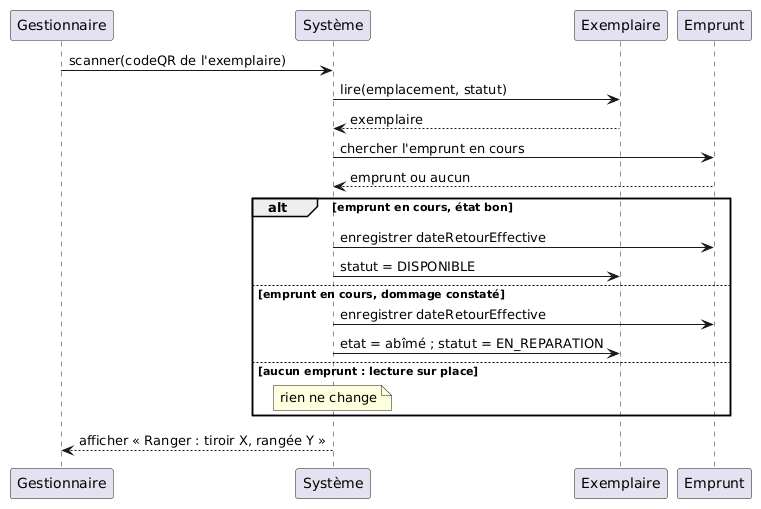

# BiblioPrêt : gestion d'une mini-bibliothèque universitaire

Projet de cours de l'EST (Fès) : conception UML puis application de gestion d'une bibliothèque universitaire.

- Application générée avec Google AI Studio

## Diagrammes UML

### Cas d'utilisation

### Activité

### États

### Séquence

